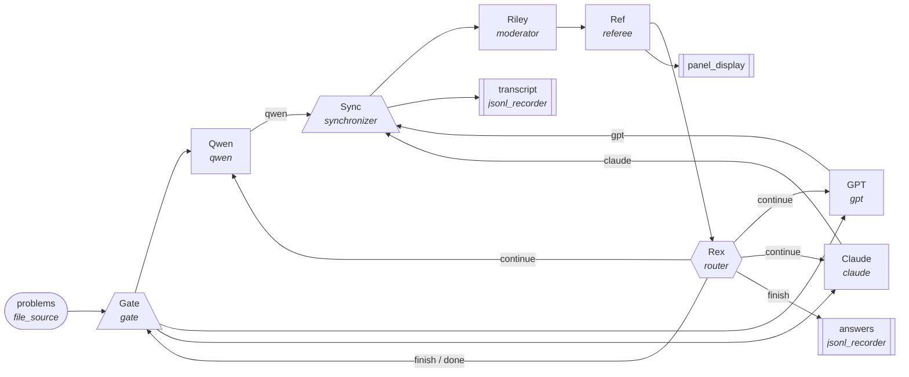

# debate

Three models answer each question. A moderator judges how far they agree
and writes a note. A referee, a few lines of Python, either finishes the
question or sends it back to the panel with the note, up to two rounds. A
gate keeps one question in the loop at a time.

    problems -> Gate -> Qwen, GPT, Claude
    Qwen -> Sync.qwen    GPT -> Sync.gpt    Claude -> Sync.claude
    Sync -> Riley -> Ref -> Rex, panel_display
    Rex.continue -> Qwen, GPT, Claude
    Rex.finish -> answers, Gate.done

As a picture (`dsl draw . --mermaid`; GitHub renders it):



drawn from this `office.md`:

```
# debate: three models answer each question; a moderator judges agreement;
# a referee sends the question back for another round or finishes it.

sources:
    problems: file_source(path="problems.jsonl")

sinks:
    answers: jsonl_recorder(path="debate_answers.jsonl")
    transcript: jsonl_recorder(path="debate_transcript.jsonl")
    panel_display

agents:
    Gate: gate
    Qwen: qwen(ai="openrouter")
    GPT: gpt(ai="openai")
    Claude: claude(ai="anthropic")
    Sync: synchronizer(on="problem_id")
    Riley: moderator
    Ref: referee(max_rounds=2)
    Rex: router(on="next")

connections:
    problems -> Gate -> Qwen, GPT, Claude
    Qwen -> Sync.qwen
    GPT -> Sync.gpt
    Claude -> Sync.claude
    Sync -> Riley -> Ref -> Rex, panel_display
    Sync -> transcript
    Rex.continue -> Qwen, GPT, Claude
    Rex.finish -> answers, Gate.done
```

- **The models judge; Python keeps the rules.** The round limit is in
  `roles/referee.py`, not in any prompt.
- **A loop needs an author.** The referee builds the next round's message
  fresh, so the panellists never receive a message that already holds
  their own field.
- **The synchronizer's key is `problem_id`.** It repeats every round,
  which is safe because the gate keeps one question in progress.
- **Three panellist files** that differ only in the name: roles take no
  parameters, so what you read is what the model reads.
- **The answer keys stay outside the office** (`answer_keys.jsonl`), so no
  model sees them. After a run, `python grade.py` compares.
